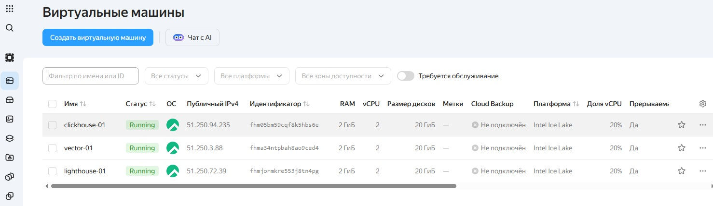
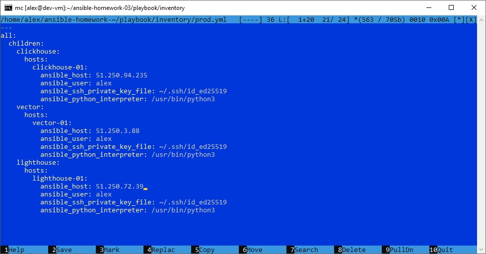
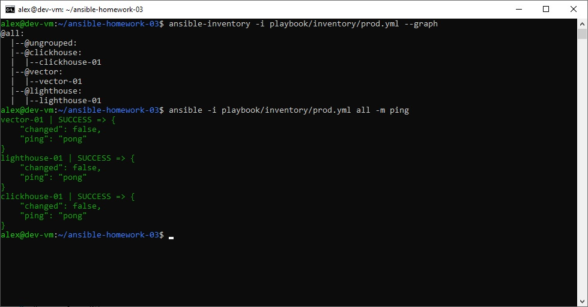
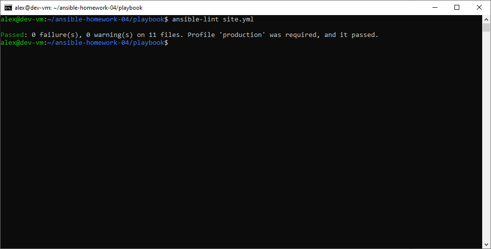
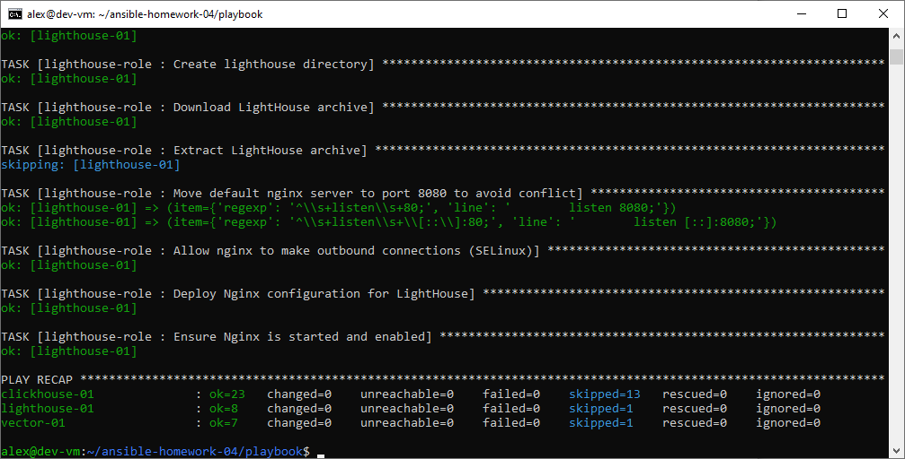
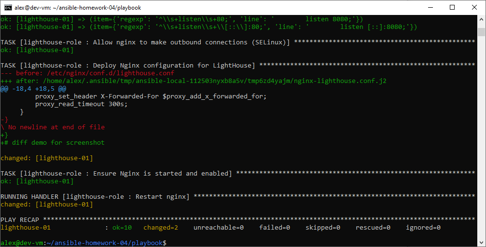
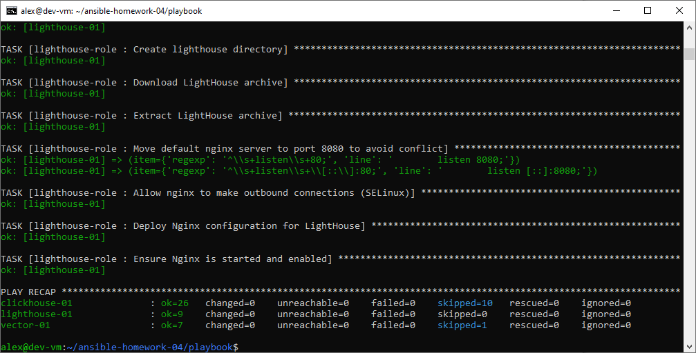

# Домашнее задание к занятию 4 «Работа с roles»

## 📖 О чём этот playbook

Playbook автоматизирует установку и настройку трёх сервисов на серверах под управлением **Rocky Linux 9** в Yandex Cloud. В отличие от ДЗ №3, вся логика вынесена в **переиспользуемые роли** — playbook стал тонким: в `site.yml` только вызовы ролей, а вся реализация лежит в отдельных репозиториях (для `vector-role` и `lighthouse-role`) или в сторонней роли из Galaxy (`clickhouse`).

| Роль | Источник | Что делает |
|---|---|---|
| `clickhouse` | [AlexeySetevoi/ansible-clickhouse](https://github.com/AlexeySetevoi/ansible-clickhouse) v1.13 | Устанавливает ClickHouse 24.8.5.115 из RPM, генерирует `config.xml`, запускает сервис, создаёт БД `logs` |
| `vector-role` | [akamsoft/vector-role](https://github.com/akamsoft/vector-role) | Скачивает Vector 0.61.0 с GitHub Releases, распаковывает, деплоит конфиг через Jinja2, запускает systemd-сервис |
| `lighthouse-role` | [akamsoft/lighthouse-role](https://github.com/akamsoft/lighthouse-role) | Устанавливает Nginx, скачивает статику VKCOM/lighthouse, деплоит конфиг с проксированием к ClickHouse |

**Три репозитория:**

- `ansible-homework-04` (этот) — playbook + inventory + `requirements.yml` + `group_vars`;
- `vector-role` — роль для Vector;
- `lighthouse-role` — роль для LightHouse.

---

## 🖥️ Окружение

- **Control node:** Debian 13, Ansible установлен через `sudo apt install ansible` (`ansible-core` 2.19+).
- **Managed hosts:** три VM в Yandex Cloud на Rocky Linux 9:



| Хост | Группа | Роль | Публичный IP |
|---|---|---|---|
| `clickhouse-01` | `clickhouse` | ClickHouse | `51.250.94.235` |
| `vector-01` | `vector` | Vector | `51.250.3.88` |
| `lighthouse-01` | `lighthouse` | LightHouse (Nginx) | `51.250.72.39` |

- Доступ по SSH с ключом `~/.ssh/id_ed25519`, пользователь `alex`.
- Коллекция `ansible.posix` установлена (`ansible-galaxy collection install ansible.posix`) — нужна для `seboolean`.

---

## 📂 Структура репозитория

```
ansible-homework-04/
├── README.md
├── .gitignore
├── images/                                 # скриншоты выполнения п. 5–8
│   ├── 01-lint.png
│   ├── 02-check.png
│   ├── 03-diff.png
│   └── 04-idempotent.png
└── playbook/
    ├── site.yml                            # 3 play, используют роли
    ├── requirements.yml                    # источники ролей (clickhouse + 2 собственные)
    ├── .ansible-lint                       # exclude_paths: roles/clickhouse/
    ├── inventory/
    │   └── prod.yml                        # 3 группы: clickhouse, vector, lighthouse
    ├── group_vars/
    │   ├── clickhouse/vars.yml             # версия, репозиторий, listen_host
    │   ├── vector/vars.yml                 # версия, URL, пути
    │   └── lighthouse/vars.yml             # clickhouse_host для прокси
    └── roles/                              # устанавливаются ansible-galaxy
        ├── clickhouse/                     # из AlexeySetevoi/ansible-clickhouse v1.13
        ├── vector-role/                    # из akamsoft/vector-role
        └── lighthouse-role/                # из akamsoft/lighthouse-role
```

> 💡 `playbook/roles/` **не коммитится** — он восстанавливается из `requirements.yml` командой `ansible-galaxy role install`. Каталог исключён через `.gitignore`.

---

## 📝 Inventory (`playbook/inventory/prod.yml`)

```yaml
---
all:
  children:
    clickhouse:
      hosts:
        clickhouse-01:
          ansible_host: 51.250.94.235
          ansible_user: alex
          ansible_ssh_private_key_file: ~/.ssh/id_ed25519
          ansible_python_interpreter: /usr/bin/python3
    vector:
      hosts:
        vector-01:
          ansible_host: 51.250.3.88
          ansible_user: alex
          ansible_ssh_private_key_file: ~/.ssh/id_ed25519
          ansible_python_interpreter: /usr/bin/python3
    lighthouse:
      hosts:
        lighthouse-01:
          ansible_host: 51.250.72.39
          ansible_user: alex
          ansible_ssh_private_key_file: ~/.ssh/id_ed25519
          ansible_python_interpreter: /usr/bin/python3
```





---

## 🚀 Установка ролей

```bash
cd playbook
ansible-galaxy role install -r requirements.yml -p roles
```

### `requirements.yml`

```yaml
---
  - src: git@github.com:AlexeySetevoi/ansible-clickhouse.git
    scm: git
    version: "1.13"
    name: clickhouse
  - src: git@github.com:akamsoft/vector-role.git
    scm: git
    version: "main"
    name: vector-role
  - src: git@github.com:akamsoft/lighthouse-role.git
    scm: git
    version: "main"
    name: lighthouse-role
```

> 💡 Если используется HTTPS (без SSH-ключей):
> ```yaml
>   - src: https://github.com/AlexeySetevoi/ansible-clickhouse.git
>     scm: git
>     version: "1.13"
>     name: clickhouse
> ```
> Аналогично для собственных ролей.

**Обновление ролей:**

```bash
ansible-galaxy role install -r requirements.yml -p roles --force
```

---

## ⚙️ Параметры (переменные)

### ClickHouse (`group_vars/clickhouse/vars.yml`)

| Переменная | Описание | Значение |
|---|---|---|
| `clickhouse_version` | Версия ClickHouse | `"24.8.5.115"` |
| `clickhouse_repo` | Базовый URL RPM-репозитория | `"https://packages.clickhouse.com/rpm/lts/"` |
| `clickhouse_repo_key` | GPG-ключ репозитория | `"https://packages.clickhouse.com/rpm/lts/repodata/repomd.xml.key"` |
| `clickhouse_listen_host` | **Список** адресов, на которых слушает ClickHouse | `["0.0.0.0"]` |

> ⚠️ **`clickhouse_listen_host` — список, а не строка!** Если задать `"0.0.0.0"` (строку), Jinja2 в шаблоне роли итерирует **посимвольно** — получаются `<listen_host>0</listen_host>` и `<listen_host>.</listen_host>`, ClickHouse падает с `Host not found: .`. Правильно — YAML-список.

### Vector (`group_vars/vector/vars.yml`)

| Переменная | Описание | Значение |
|---|---|---|
| `vector_version` | Версия Vector | `"0.61.0"` |
| `vector_archive` | Имя архива | `vector-{{ vector_version }}-x86_64-unknown-linux-gnu.tar.gz` |
| `vector_download_url` | URL для скачивания | `https://github.com/vectordotdev/vector/releases/download/v{{ vector_version }}/{{ vector_archive }}` |
| `vector_install_dir` | Каталог установки | `"/opt/vector"` |
| `vector_bin` | Путь к бинарнику | `{{ vector_install_dir }}/vector-x86_64-unknown-linux-gnu/bin/vector` |

### LightHouse (`group_vars/lighthouse/vars.yml`)

| Переменная | Описание | Значение |
|---|---|---|
| `clickhouse_host` | Адрес ClickHouse для прокси | `"{{ hostvars[groups['clickhouse'][0]]['ansible_host'] }}"` |
| `clickhouse_port` | Порт ClickHouse HTTP | `8123` |

> 💡 Параметризация `clickhouse_host` — важное отличие от ДЗ №3: роль **не использует** `hostvars['clickhouse-01']['ansible_host']` напрямую (роль не должна знать о других хостах), а принимает адрес через переменную, которую задаёт плейбук.

---

## 🏷️ Теги

| Тег | Что выполняется |
|---|---|
| `clickhouse` | Все задачи роли `clickhouse` |
| `vector` | Все задачи роли `vector-role` |
| `lighthouse` | Все задачи роли `lighthouse-role` |
| `vector_install` | Установка Vector (внутри роли) |
| `vector_configure` | Настройка Vector (внутри роли) |
| `lighthouse_install` | Установка LightHouse (nginx, скачивание статики) |
| `lighthouse_configure` | Настройка LightHouse (конфиг, SELinux, запуск) |

**Примеры:**

```bash
# Только ClickHouse
ansible-playbook -i inventory/prod.yml site.yml --tags clickhouse

# Только установка LightHouse (без конфигурации)
ansible-playbook -i inventory/prod.yml site.yml --tags lighthouse_install

# Всё, кроме конфигурации
ansible-playbook -i inventory/prod.yml site.yml --skip-tags configure

# Только настройка Vector
ansible-playbook -i inventory/prod.yml site.yml --tags vector_configure
```

---

## 🚀 Использование

### 1. Подготовка inventory

Отредактируйте `playbook/inventory/prod.yml`, указав публичные IP ваших ВМ.

### 2. Линтинг

```bash
cd playbook
ansible-lint site.yml
```

Ожидаемый результат: `Passed: 0 failure(s), 0 warning(s)`.

### 3. Проверка синтаксиса

```bash
ansible-playbook -i inventory/prod.yml site.yml --syntax-check
```

### 4. Пробный прогон (`--check`)

```bash
ansible-playbook -i inventory/prod.yml site.yml --check
```

Ничего не изменяет — показывает, что было бы сделано. На уже настроенной системе — `changed=0` для всех хостов.

### 5. Прогон с диффом (`--diff`)

```bash
ansible-playbook -i inventory/prod.yml site.yml --diff
```

Показывает изменения в файлах (`template`, `copy`, `lineinfile`).

### 6. Полный прогон

```bash
ansible-playbook -i inventory/prod.yml site.yml
```

### 7. Проверка на хостах

```bash
# ClickHouse
ssh alex@51.250.94.235 "sudo ss -tlnp | grep 8123; clickhouse-client -q 'SHOW DATABASES'"

# Vector
ssh alex@51.250.3.88 "sudo systemctl status vector --no-pager | head -5; vector validate /etc/vector/vector.yaml"

# LightHouse
ssh alex@51.250.72.39 "sudo systemctl status nginx --no-pager | head -5"
curl -s http://51.250.72.39/ | grep -i "<title>"
curl -s "http://51.250.72.39/clickhouse/?query=SELECT%20version()"
```

---

## 🔍 Что делает playbook

### Play 1. Install and configure ClickHouse (`hosts: clickhouse`)

**Роль `clickhouse`** (v1.13) делает основную работу:

1. Проверяет поддержку SSE 4.2 и совместимость дистрибутива.
2. Импортирует GPG-ключ, добавляет RPM-репозиторий ClickHouse.
3. Устанавливает пакеты `clickhouse-common-static`, `clickhouse-client`, `clickhouse-server` нужной версии.
4. Генерирует `config.xml` с учётом `clickhouse_listen_host` (список).
5. Генерирует `users.xml` (пользователь `default` с ограничением сетей `127.0.0.1`, `::1`).
6. Запускает `clickhouse-server` и ждёт готовности через `wait_for`.
7. Создаёт базу `logs` (если её нет).

**`post_tasks` в playbook** (после роли):

```yaml
  post_tasks:
    - name: Remove legacy listen.xml (conflicts with role-generated config)
      ansible.builtin.file:
        path: /etc/clickhouse-server/config.d/listen.xml
        state: absent
      notify: Restart ClickHouse

    - name: Allow default ClickHouse user to connect from any IP (for LightHouse)
      ansible.builtin.copy:
        dest: /etc/clickhouse-server/users.d/zz-default-network.xml
        content: |
          <clickhouse>
              <users>
                  <default>
                      <networks replace="replace">
                          <ip>::/0</ip>
                      </networks>
                  </default>
              </users>
          </clickhouse>
        owner: clickhouse
        group: clickhouse
        mode: '0640'
      notify: Restart ClickHouse
```

**Зачем эти `post_tasks`:**

- **`Remove legacy listen.xml`** — в ДЗ №3 мы создавали `config.d/listen.xml` с `<listen_host>0.0.0.0</listen_host>`. Роль генерирует `config.xml` со своим `<listen_host>`, и два файла конфликтуют — ClickHouse пытается открыть порт 9009 дважды и падает с `Address already in use`. Задача удаляет `listen.xml`, если он остался.
- **`Allow default ClickHouse user from any IP`** — пользователь `default` в `users.xml` ограничен сетями `127.0.0.1` и `::1`. При проксировании LightHouse → ClickHouse подключение идёт с IP `lighthouse-01`, и ClickHouse возвращает `Code: 516 Authentication failed` (маскировка сетевого запрета под ошибку аутентификации). Override с `replace="replace"` и `<ip>::/0</ip>` открывает доступ со всех IP.

**Handler `Restart ClickHouse`** перезапускает `clickhouse-server` при изменении любого из этих файлов.

### Play 2. Install and configure Vector (`hosts: vector`)

**Роль `vector-role`** использует модули **`get_url`, `unarchive`, `file`, `template`, `systemd`**:

1. Создаёт каталоги `/opt/vector`, `/etc/vector`, `/var/lib/vector` через `file`.
2. Скачивает архив `vector-0.61.0-x86_64-unknown-linux-gnu.tar.gz` с GitHub Releases через `get_url`.
3. Распаковывает в `/opt/vector` через `unarchive` (`remote_src: true`, `creates: {{ vector_bin }}` — идемпотентность).
4. Создаёт симлинк `/usr/local/bin/vector → {{ vector_bin }}` через `file`.
5. Деплоит `/etc/vector/vector.yaml` из `templates/vector.yml.j2` через `template`.
6. Деплоит `/etc/systemd/system/vector.service` из `templates/vector.service.j2` через `template`.
7. Запускает и включает сервис через `systemd`.

**Handler `Restart vector service`** срабатывает **только** при изменении конфига или unit-файла (`notify` от задач `template`).

### Play 3. Install and configure LightHouse (`hosts: lighthouse`)

**Роль `lighthouse-role`**:

1. Устанавливает `nginx` через `dnf`.
2. Создаёт каталог `/usr/share/nginx/lighthouse` через `file`.
3. Скачивает архив `VKCOM/lighthouse` (`master`) через `get_url`.
4. Распаковывает с `--strip-components=1` в `lighthouse_dest` через `unarchive`.
5. Переносит дефолтный `server` nginx с порта 80 на 8080 через `lineinfile` — устраняет `conflicting server name "_"`.
6. Включает `httpd_can_network_connect` для SELinux через `ansible.posix.seboolean` (без этого nginx не может проксировать к ClickHouse и отдаёт `502`).
7. Деплоит `/etc/nginx/conf.d/lighthouse.conf` из `templates/nginx-lighthouse.conf.j2` через `template`:
   - `root` на `{{ lighthouse_dest }}`;
   - `try_files` для SPA-роутинга;
   - `location /clickhouse/` → `proxy_pass http://{{ clickhouse_host }}:{{ clickhouse_port }}/`.
8. Запускает и включает `nginx` через `systemd`.

**Handler `Restart nginx`** срабатывает при изменении конфига или при переносе дефолтного server.

---

## ✅ Проверки (п. 5–8)

### П. 5. `ansible-lint site.yml` — 0 ошибок

```bash
cd playbook
ansible-lint site.yml
# Passed: 0 failure(s), 0 warning(s)
```

Сторонняя роль `clickhouse` исключена из линтера через `.ansible-lint`, потому что написана в стиле Ansible 2.8 (без FQCN, старый `meta`, без `mode`) — её стиль не наша зона ответственности:

```yaml
---
profile: production
exclude_paths:
  - roles/clickhouse/
```



### П. 6. `--check` — план без изменений

```bash
ansible-playbook -i inventory/prod.yml site.yml --check
# clickhouse-01 : ok=26  changed=0  failed=0
# vector-01     : ok=7   changed=0  failed=0
# lighthouse-01 : ok=9   changed=0  failed=0
```



### П. 7. `--diff` — изменения применяются

Пример с временным демо-комментарием в `templates/nginx-lighthouse.conf.j2` (для наглядности диффа):

```bash
ansible-playbook -i inventory/prod.yml site.yml --limit lighthouse --diff
# TASK [Deploy Nginx configuration] → changed
# RUNNING HANDLER [Restart nginx] → changed
# PLAY RECAP: lighthouse-01 : ok=10  changed=2  failed=0
```



### П. 8. Повторный `--diff` — идемпотентность

```bash
ansible-playbook -i inventory/prod.yml site.yml --diff
# clickhouse-01 : ok=26  changed=0  failed=0  skipped=10
# vector-01     : ok=7   changed=0  failed=0  skipped=1
# lighthouse-01 : ok=9   changed=0  failed=0
```

Handler'ы не запускаются, потому что нет изменений.



---

## 🔁 Идемпотентность

Playbook идемпотентен: повторный запуск не вносит изменений. Механизмы:

| Задача | Как достигается идемпотентность |
|---|---|
| `get_url` | Не перекачивает файл, если размер/checksum совпадают |
| `unarchive` | `creates: {{ vector_bin }}` — пропускает распаковку, если бинарник уже есть (`skipped=1`) |
| `file` (каталоги, симлинки) | Идемпотентен по природе |
| `template` | Не помечает `changed`, если содержимое файла не изменилось |
| `copy` (zz-default-network.xml) | Не помечает `changed`, если содержимое совпадает |
| `lineinfile` | Не меняет строку, если она уже соответствует `line` |
| `seboolean` | `persistent: true` + `state: true` — если уже `on`, задача `ok` |
| `command` (создание БД) | `failed_when: rc not in (0, 82)`, `changed_when: rc == 0` |
| Handler'ы | Запускаются только при фактическом изменении (`notify` + `changed`) |

Проверено: повторный запуск с `--diff` даёт `changed=0` для всех трёх хостов.

---

## 📌 Особенности и решения

### 1. `clickhouse_listen_host` — список, а не строка

Если задать `clickhouse_listen_host: "0.0.0.0"` (строку), Jinja2 в шаблоне роли итерирует **посимвольно**:

```xml
<listen_host>0</listen_host>
<listen_host>.</listen_host>
<listen_host>0</listen_host>
...
```

ClickHouse падает с `Listen [.]:9009 failed: Host not found: .`. Правильно — **список**:

```yaml
clickhouse_listen_host:
  - "0.0.0.0"
```

### 2. `users.d/zz-default-network.xml` — обязателен для LightHouse

Пользователь `default` в `users.xml` (генерируется ролью) ограничен сетями `127.0.0.1` и `::1`. При проксировании nginx подключается к ClickHouse с IP `lighthouse-01`, и ClickHouse возвращает `Code: 516 Authentication failed` — это маскировка сетевого запрета. Override с `replace="replace"` и `<ip>::/0</ip>` открывает доступ со всех IP.

### 3. `.ansible-lint` с `exclude_paths`

Сторонняя роль `clickhouse` написана в стиле Ansible 2.8 (без FQCN, старый `meta`, без `mode`, без `name` у задач). Её стиль — не наша зона ответственности. Исключаем из линтера:

```yaml
---
profile: production
exclude_paths:
  - roles/clickhouse/
```

### 4. SELinux на Rocky 9

`httpd_can_network_connect` по умолчанию `off`. Без его включения nginx не может проксировать к ClickHouse и отдаёт `502 Bad Gateway` с записью в `/var/log/nginx/error.log`:

```
connect() to 51.250.94.235:8123 failed (13: Permission denied) while connecting to upstream
```

Задача `ansible.posix.seboolean` закреплена в `lighthouse-role`.

### 5. Роль `lighthouse-role` не зависит от `hostvars` других хостов

В ДЗ №3 `nginx-lighthouse.conf.j2` содержал `hostvars['clickhouse-01']['ansible_host']` — роль знала о конкретном хосте. В ДЗ №4 роль принимает адрес ClickHouse через переменную `clickhouse_host` (по умолчанию `127.0.0.1`), а значение задаётся в `group_vars/lighthouse/vars.yml` playbook. Это делает роль переиспользуемой: её можно применить в любом inventory, где есть хост LightHouse.

### 6. Вектор: путь к бинарнику без версии

Архив `vector-<version>-x86_64-unknown-linux-gnu.tar.gz` распаковывается в каталог `vector-x86_64-unknown-linux-gnu/` — **без версии в имени**. Это важно для `unarchive` с `creates: {{ vector_bin }}`:

```yaml
vector_bin: "{{ vector_install_dir }}/vector-x86_64-unknown-linux-gnu/bin/vector"
```

Если ошибочно указать `vector-{{ vector_version }}-...` — `unarchive` будет каждый раз распаковывать заново (файла `creates` нет), и задача `Unarchive Vector` не станет идемпотентной.

---

## 📋 Требования

- Ansible 2.10+ (`ansible-core` 2.19 проверен).
- Коллекция `ansible.posix` (`ansible-galaxy collection install ansible.posix`).
- `ansible-lint` (для проверки).
- SSH-доступ к трём VM Rocky Linux 9 в Yandex Cloud.
- Python 3.9+ на управляемых хостах (Rocky 9 — по умолчанию).
- Открытые порты в Security Group Yandex Cloud:
  - `22` (SSH) — для всех ВМ;
  - `8123` (ClickHouse HTTP) — для `clickhouse-01`;
  - `80` (HTTP) — для `lighthouse-01`.
- Доступ в интернет с управляемых хостов (`packages.clickhouse.com`, `github.com`, `yum.vector.dev`).

---

## 🖼️ Скриншоты выполнения заданий №5–8

| Пункт | Файл | Что показано |
|---|---|---|
| п. 5 | `images/01-lint.png` | `ansible-lint site.yml` → `Passed: 0 failure(s)` |
| п. 6 | `images/02-check.png` | `--check` → `changed=0 failed=0` для трёх хостов |
| п. 7 | `images/03-diff.png` | `--diff` с изменением → дифф + `changed=2` |
| п. 8 | `images/04-idempotent.png` | повторный `--diff` → `changed=0` для трёх хостов |

---

- **Репозиторий:** https://github.com/akamsoft/ansible-homework-04

### Репозитории ролей

- **vector-role:** https://github.com/akamsoft/vector-role
- **lighthouse-role:** https://github.com/akamsoft/lighthouse-role
- **clickhouse:** https://github.com/AlexeySetevoi/ansible-clickhouse (v1.13, из Galaxy)

---
